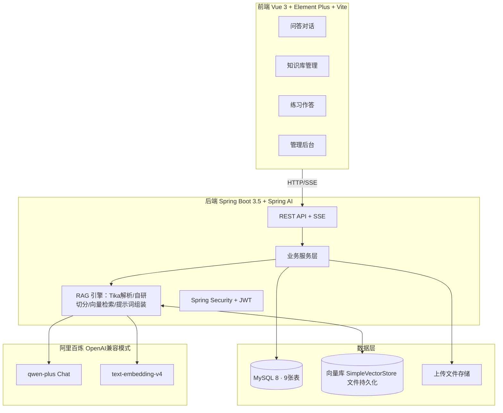
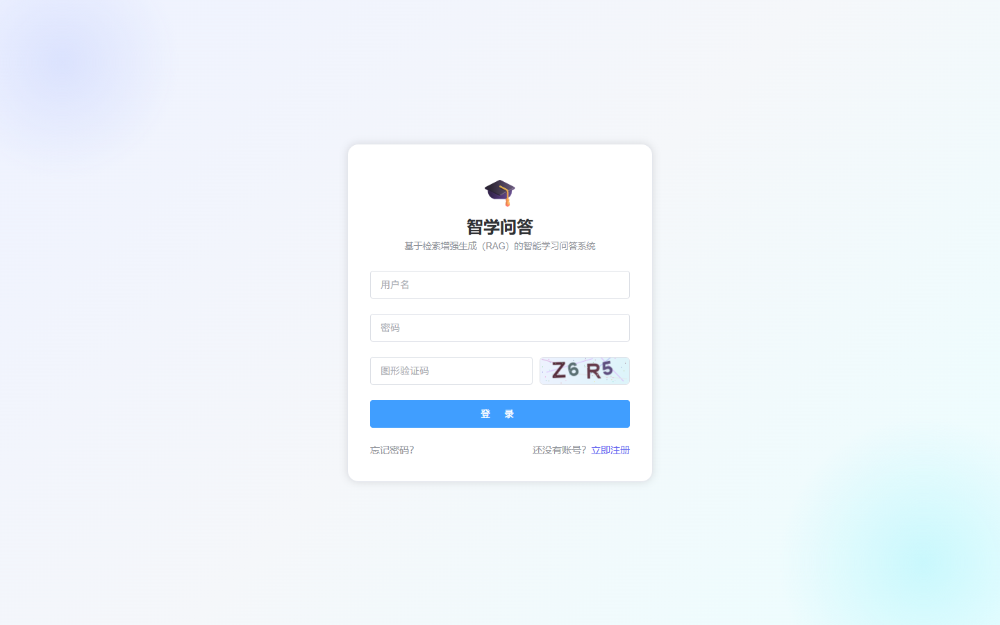
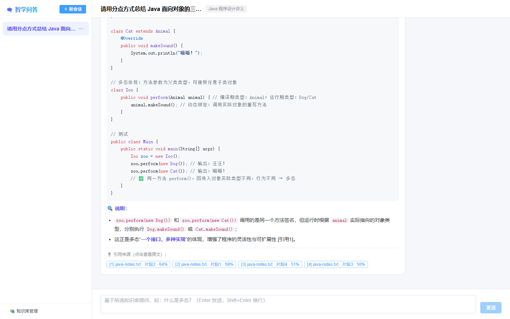
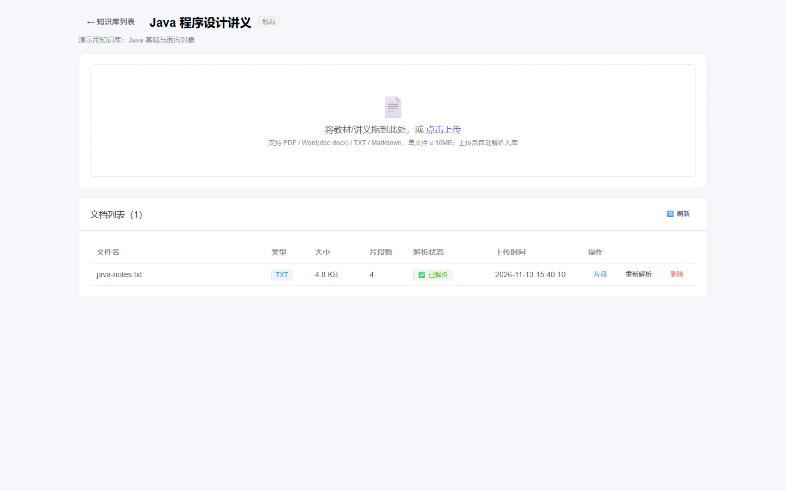
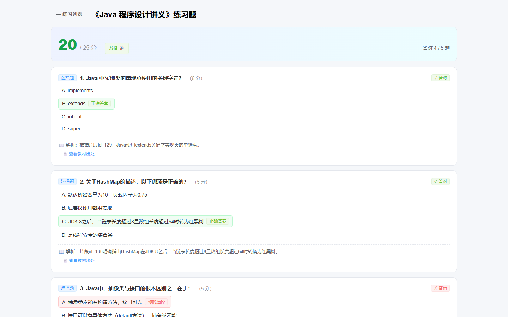
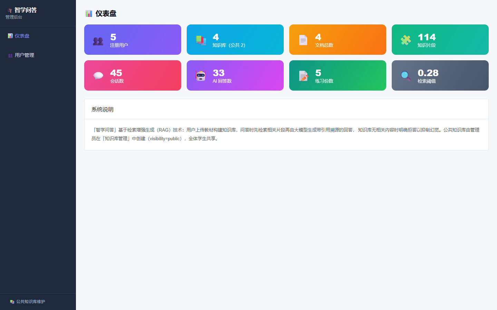
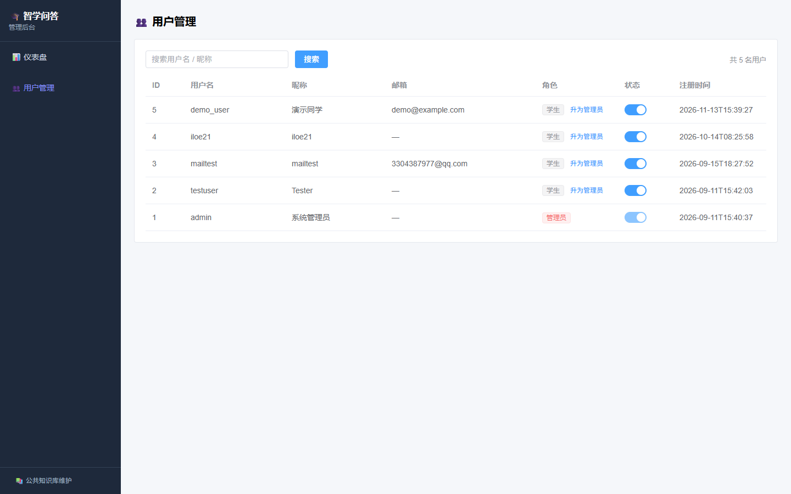

# 🎓 智学问答（ZhiXue Q&A）

> 基于 **RAG（检索增强生成）** 的智能学习问答系统 —— 上传你的教材，获得**带引用溯源**的 AI 答疑，还能一键生成练习题并自动判分。

      

## 💡 为什么做这个

直接把 ChatGPT 类大模型当"学习助手"有三个硬伤：**会一本正经地编造（幻觉）**、**不了解你的指定教材**、**答案无法核对出处**。

本系统用 RAG 解决：回答前先检索你上传的教材片段，大模型**只根据检索结果作答**并标注引用来源；知识库没有的内容**明确拒答**。

**实测数据**（12 题对照实验，qwen-plus，LLM 评审随机换序打分）：

| 指标 | 本系统（RAG） | 直接问大模型 |
|------|:---:|:---:|
| 综合得分（满分 2） | **1.83** | 1.58 |
| 教材外问题（应拒答） | **1.67** | 1.00 |
| 幻觉作答 | **0 次** | 1 次 |
| 事实性错误 | **0 处** | 1 处 |

> 详见 [实验报告](file/实验报告-RAG对比实验.md)，原始数据与复现脚本见 `experiments/`。

## ✨ 功能特性

- 📚 **知识库管理** —— 上传 PDF / Word / TXT / Markdown 教材，自动完成 `解析 → 切分 → 向量化` 入库；支持私有库与管理员维护的公共课程库
- 💬 **智能问答** —— 多轮对话、SSE 流式输出（打字机效果）、回答 Markdown 渲染 + 代码高亮、可跨多个知识库检索
- 🔍 **引用溯源** —— 回答标注 `[引用N]`，点击引用卡片查看教材原文片段与相关度得分
- 🛡️ **幻觉抑制双防线** —— 相似度阈值拒答（检索层）+ 提示词忠实性约束（生成层）
- 📝 **练习题生成** —— AI 基于教材片段出选择题/填空题，在线作答、服务端自动判分、附解析与出题出处
- 👤 **用户体系** —— JWT 认证、图形验证码（纯 Java2D 实现）、QQ 邮箱验证码找回密码
- 🛠️ **管理后台** —— 八维统计仪表盘、用户禁用/角色管理、公共知识库维护

## 🏛️ 系统架构



**RAG 两条链路**：

```
入库：文档上传 → Tika 提取文本 → 重叠切分(800字符/重叠120,段落边界回退) → chunk_meta 入库 → 分批向量化 → 向量库持久化
问答：提问 → 向量化 → Top-K=5 检索(阈值0.28,按知识库范围过滤) → 命中0则拒答 → 编号引用+历史的提示词组装 → 流式生成 → SSE推送 → 引用溯源
```

## 📸 界面预览

| 登录（图形验证码 + 找回密码） | 智能问答（Markdown 渲染 + 引用溯源卡片） |
|:---:|:---:|
|  |  |
| **知识库详情（上传 + 解析状态）** | **练习判分（得分 + 解析 + 出题出处）** |
|  |  |
| **管理后台仪表盘（八维统计）** | **用户管理** |
|  |  |

> 截图由 `frontend/scripts/capture-screenshots.mjs` 无头浏览器自动生成（复用本机 Edge，登录态经 localStorage 注入）。

## 🚀 快速开始

### 环境要求

| 依赖 | 版本 |
|------|------|
| JDK | 21+ |
| Node.js | 18+（建议 20+） |
| MySQL | 8.0+ |
| 大模型 API Key | 阿里百炼（或其他 OpenAI 兼容服务） |

### 1. 初始化数据库

```bash
mysql -uroot -p --default-character-set=utf8mb4 < backend/src/main/resources/init.sql
```

### 2. 配置密钥

复制配置模板并填入你的信息（该文件已被 .gitignore 排除，不会泄露）：

```bash
cp backend/src/main/resources/application-local.example.yml backend/src/main/resources/application-local.yml
```

```yaml
spring:
  datasource:
    password: 你的MySQL密码   # application.yml 中为 change_me 占位符
  ai:
    openai:
      api-key: sk-你的百炼Key
      base-url: https://dashscope.aliyuncs.com/compatible-mode
      chat:
        options:
          model: qwen-plus
      embedding:
        options:
          model: text-embedding-v4
  mail:            # 可选：忘记密码邮件功能
    username: 你的QQ邮箱@qq.com
    password: SMTP授权码
```

> 数据库账号默认为 `root`，如不同可在 `application-local.yml` 中补充 `spring.datasource.username`（或用环境变量 `DB_USERNAME` / `DB_PASSWORD`）。

### 3. 启动后端

```bash
cd backend
./mvnw spring-boot:run        # Windows: mvnw.cmd spring-boot:run
```

### 4. 启动前端

```bash
cd frontend
npm install
npm run dev                   # 打开 http://localhost:5173
```

### 5. 登录

- 管理员：`admin / admin123`（首次启动自动创建，**请立即修改密码**）
- 或自行注册学生账号

### 6. Docker 一键部署（可选）

不装 JDK/Node/MySQL 也能跑，三个服务（MySQL + 后端 + Nginx 前端）一条命令拉起：

```bash
cp .env.example .env          # 填入 AI_API_KEY（阿里百炼）
docker compose up -d --build  # 打开 http://localhost:8080
```

Nginx 容器统一入口：静态资源 + `/api`、`/uploads` 反代后端（SSE 已关闭缓冲）。MySQL 数据、上传文档、向量库文件均为命名卷，`docker compose down` 不丢数据。

## ⚙️ 可调参数

| 配置项 | 说明 | 默认值 |
|--------|------|--------|
| `app.parse.chunk-chars` | 切分块大小（字符） | 800 |
| `app.parse.overlap-chars` | 块间重叠 | 120 |
| `app.parse.embedding-batch-size` | Embedding 单批条数（百炼限制 ≤10） | 6 |
| `app.rag.top-k` | 检索返回片段数 | 5 |
| `app.rag.similarity-threshold` | 相似度阈值（**换嵌入模型需重新校准**） | 0.28 |
| `jwt.expiration` | Token 有效期（毫秒） | 86400000 |

> 阈值 0.28 来自实测校准：text-embedding-v4 下相关内容得分 0.31~0.43、无关内容 0.18~0.26。

## 🧪 单元测试与 CI

`backend/src/test` 覆盖四个核心契约（30 用例，`mvn test` 或 CI 自动执行）：

| 测试类 | 锁定行为 |
|--------|----------|
| `TextChunkSplitterTest` | 窗口切分、overlap 重叠、段落边界回退、行尾归一化 |
| `ExerciseGraderTest` | 选择题大小写匹配、填空题多答案/全半角/空白归一化 |
| `ExerciseSubmitTest` | 服务端累分、一次性提交、归属校验、答案不下发 |
| `RagChatServiceCitationTest` | 提示词 `[引用N]` 编号与 Citation/chunkIndex 对齐 |
| `JwtUtilTest` | claims 契约、篡改/过期/异密钥拒收 |

GitHub Actions（`.github/workflows/ci.yml`）在每次 push/PR 时跑 `mvn test`，徽章见页首。

## 🧪 对比实验

内置自动化实验脚本（12 题测试集 + LLM 评审员 + 随机换序消偏）：

```bash
# 启动后端并登录获取 token 后：
TOKEN=<你的token> node experiments/run-experiment.mjs
# 结果输出至 testdata/experiment/results.json
```

## 📁 项目结构

```
├── backend/                  # Spring Boot 后端
│   └── src/main/java/com/graduation/rag/
│       ├── config/           # Security(JWT)/向量库/异步线程池/MyBatis-Plus/管理员初始化
│       ├── controller/       # Auth/Kb/Document/Chat(SSE)/Exercise/Admin 接口
│       ├── service/          # 认证/验证码/密码重置/知识库/文档解析/RAG问答/练习/管理
│       ├── security/         # JwtUtil/JwtAuthenticationFilter
│       ├── entity/ mapper/ dto/ exception/ util/(自研文本切分器)
│       ├── src/test/          # 单元测试（切分/判分/引用对齐/JWT）
│       └── resources/         # application.yml / init.sql(9张表)
├── frontend/                 # Vue 3 前端（含容器化 Dockerfile + nginx.conf）
│   └── src/
│       ├── api/              # auth/kb/chat/exercise/admin 接口封装
│       ├── views/            # 登录/注册/首页/知识库×2/问答/练习×2/管理后台×3
│       ├── store/ router/ utils/
├── .github/workflows/ci.yml  # push/PR 自动跑后端单元测试
├── docker-compose.yml        # MySQL+后端+前端一键部署
├── experiments/              # RAG vs 直接问答对比实验脚本
├── testdata/                 # 测试文档/题集/实验结果
└── file/                     # 设计文档/实验报告
```

## 🔒 安全设计

- 密码 BCrypt 加密，接口响应 `@JsonIgnore` 双重防泄露
- JWT 无状态认证 + 接口级鉴权（`@PreAuthorize`）+ 资源所有权校验
- 登录图形验证码（一次性使用，防暴力破解）
- 找回密码：6 位验证码 10 分钟过期 + 60 秒发送限流 + 统一错误提示防用户枚举
- 上传安全：扩展名白名单 + 大小限制 + 文件名清洗（防路径穿越）+ UUID 存储名
- 练习判分全部在服务端完成，待作答状态接口不下发答案
- 密钥仅存 `application-local.yml`（gitignore），生产可用环境变量覆盖

## 🛠️ 技术栈

Spring Boot 3.5 · Spring AI 1.1（OpenAI 兼容接入阿里百炼）· Spring Security + JWT(jjwt) · MyBatis-Plus · Apache Tika · MySQL 8 · Vue 3 · Element Plus · Vite · Pinia

## 📖 文档

- [需求分析与系统设计](file/需求分析与系统设计.md) —— 用例/架构/数据库/接口/技术方案
- [RAG 对比实验报告](file/实验报告-RAG对比实验.md) —— 实验设计/数据/案例分析

## 🗺️ Roadmap

- [x] AI 回答 Markdown 渲染 + 代码高亮
- [ ] 暗色模式
- [x] Docker Compose 一键部署
- [ ] 对话导出 Markdown
- [ ] 向量库升级 pgvector/Milvus（大数据量场景）
- [ ] 重排序（Rerank）提升检索精度

## 📄 License

[MIT](LICENSE) © 2026 iloe21

## 🤝 欢迎交流

Issue / PR 都欢迎。如果这个项目对你有帮助，点个 Star ⭐ 就是最好的支持！
