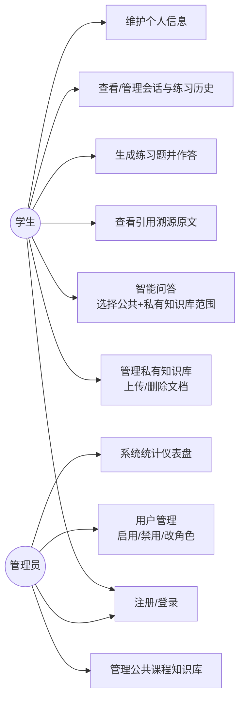
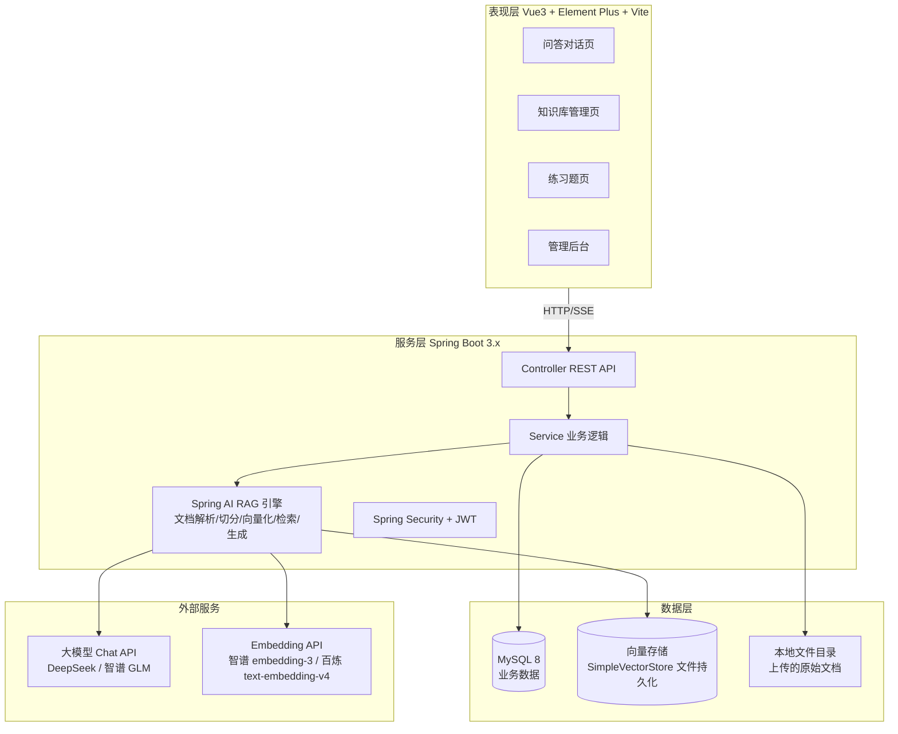
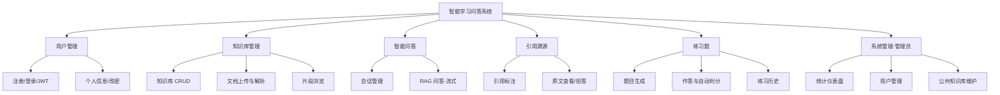
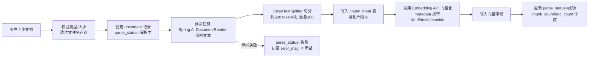
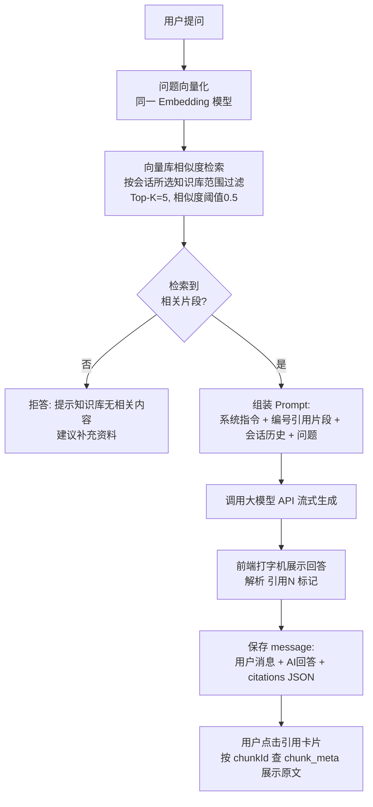
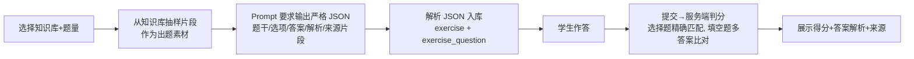
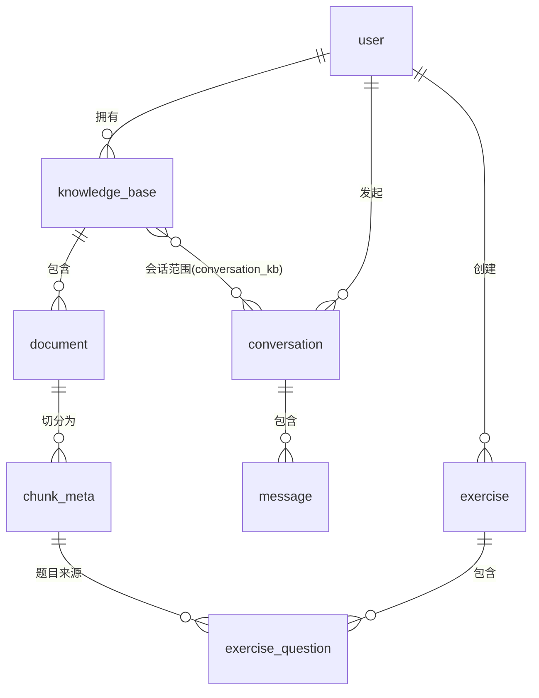

# 基于RAG的智能学习问答系统 — 需求分析与系统设计

> 本文档为系统核心设计文档，覆盖需求分析与系统设计。
> 设计决策依据：2026-09 确认的三个产品决定（角色=学生+管理员；知识库=公共+私有；练习题=选择题+填空题自动判分）。

---

## 一、需求分析

### 1.1 系统目标与用户群体

**系统目标**：构建一个基于检索增强生成（RAG）技术的 Web 智能学习问答系统。学生上传教材/讲义构建知识库后，可获得**基于资料、带引用溯源**的智能问答服务，并能针对知识点生成练习题进行自测，解决通用大模型"幻觉"和"不可溯源"在学习场景中的可靠应用问题。

**用户群体**：

| 角色 | 描述 | 典型场景 |
|------|------|----------|
| 学生用户 | 系统主要使用者，高校学生 | 上传《Java 程序设计》PDF 建库 → 提问"什么是多态" → 获得带教材出处的回答 → 生成 10 道选择题自测 |
| 系统管理员 | 教师或系统维护者 | 维护公共课程知识库供全体学生使用；管理用户账号；查看系统运行统计 |

### 1.2 功能需求

#### 1.2.1 用例图



#### 1.2.2 功能模块需求明细

**① 用户管理模块**

| 功能点 | 角色 | 说明 |
|--------|------|------|
| 注册 | 游客 | 用户名唯一，密码 BCrypt 加密存储 |
| 登录 | 游客 | 颁发 JWT Token（24h 有效） |
| 个人信息 | 学生/管理员 | 修改昵称、邮箱、头像 |
| 修改密码 | 学生/管理员 | 需验证原密码 |
| 用户管理 | 管理员 | 用户列表、启用/禁用、修改角色 |

**② 知识库管理模块**

| 功能点 | 角色 | 说明 |
|--------|------|------|
| 创建知识库 | 学生（私有）/管理员（公共或私有） | 名称、描述、可见性（private/public） |
| 上传文档 | 知识库所有者 | 支持 PDF / Word(docx) / TXT / Markdown，单文件 ≤ 10MB |
| 文档解析 | 系统 | 异步解析：提取文本→切分→向量化→入库，状态可见（解析中/成功/失败） |
| 文档列表 | 知识库可见者 | 显示文件名、类型、大小、片段数、解析状态 |
| 片段浏览 | 知识库可见者 | 分页查看文档切分后的文本片段 |
| 删除文档/知识库 | 所有者/管理员 | 级联删除向量数据与片段元数据 |

**③ 智能问答模块**

| 功能点 | 角色 | 说明 |
|--------|------|------|
| 新建会话 | 学生 | 选择本次会话的知识库范围（公共库 + 自己的私有库，可多选） |
| 提问 | 学生 | 多轮对话；流式输出（打字机效果） |
| 会话列表 | 学生 | 按更新时间排序，支持重命名、删除 |
| 历史记录 | 学生 | 会话内消息持久化，可随时回看 |

**④ 引用溯源模块**

| 功能点 | 角色 | 说明 |
|--------|------|------|
| 引用标注 | 系统 | 回答中以 [引用N] 标记来源片段 |
| 引用卡片 | 学生 | 展示来源文档名、片段序号、相关度分数 |
| 原文查看 | 学生 | 点击引用弹出对应文档片段原文 |
| 拒答机制 | 系统 | 检索不到相关内容时明确告知"知识库未找到相关内容"，不编造 |

**⑤ 练习题生成模块**

| 功能点 | 角色 | 说明 |
|--------|------|------|
| 生成练习 | 学生 | 选择知识库 + 题量（选择题 N 道 / 填空题 M 道），大模型基于知识库内容出题 |
| 在线作答 | 学生 | 选择题单选、填空题文本输入 |
| 自动判分 | 系统 | 服务端判分：选择题精确匹配；填空题支持多答案/去空格比对 |
| 答案与解析 | 学生 | 交卷后展示正确答案、解析、来源片段 |
| 练习历史 | 学生 | 历次练习的得分记录 |

**⑥ 系统管理模块（管理员）**

| 功能点 | 说明 |
|--------|------|
| 统计仪表盘 | 用户数、知识库数、文档数、片段数、问答消息数、练习题数 |
| 公共知识库维护 | 创建/管理 visibility=public 的课程知识库 |
| 用户管理 | 见用户管理模块 |

### 1.3 非功能需求

| 类别 | 需求 |
|------|------|
| 性能 | 问答检索环节 < 500ms；整体首字响应主要取决于大模型 API（目标 < 5s）；10MB 内 PDF 解析 < 60s（异步执行，不阻塞界面） |
| 安全 | 密码 BCrypt 加密；JWT 认证；接口级角色鉴权（防越权）；大模型 API Key 存于环境变量不入 Git；上传文件类型白名单 + 大小限制 + 文件名清洗（防路径穿越） |
| 易用性 | 对话式交互；引用可视化；解析/生成过程有进度与状态提示 |
| 可靠性 | 文档解析失败可重试且有错误信息；大模型 API 异常时友好降级提示 |
| 可扩展性 | 大模型厂商可替换（Spring AI 抽象层）；向量存储可升级（SimpleVectorStore → pgvector/Milvus）而不改业务代码 |

---

## 二、系统总体设计

### 2.1 系统架构设计

采用**前后端分离的三层架构**，RAG 链路由 Spring AI 统一封装：



**分层职责**：

| 层 | 职责 |
|----|------|
| 表现层 | 页面交互、SSE 流式接收、状态管理（Pinia）、路由守卫 |
| 服务层 | REST API、业务逻辑、认证鉴权、RAG 链路编排 |
| 数据层 | MySQL 存业务数据与片段元数据；向量库存嵌入向量（Document id 与 chunk_meta.id 对齐，保证引用一致）；磁盘存原始文件 |

### 2.2 功能模块结构图



### 2.3 核心流程设计

**流程一：知识库构建（文档上传 → 可检索）**



**流程二：智能问答（RAG 检索增强）**



**流程三：练习题生成与判分**



### 2.4 技术选型明细

| 类别 | 选型 | 说明 |
|------|------|------|
| 后端框架 | Spring Boot 3.x（Java 21） | 本机 JDK 21 已就绪 |
| RAG 框架 | Spring AI | ChatClient / EmbeddingModel / DocumentReader / TokenTextSplitter / VectorStore 全家桶 |
| 文档解析 | Apache Tika + PDFBox | 覆盖 PDF/Word/TXT/MD |
| ORM | MyBatis-Plus | 简化 CRUD |
| 认证 | Spring Security + JWT (jjwt) | 无状态认证 + 角色鉴权 |
| 数据库 | MySQL 8.0 | 本机 8.0.45 已就绪 |
| 向量存储 | Spring AI SimpleVectorStore | 文件持久化，零安装；向量 id 对齐 chunk_meta.id |
| Chat 大模型 | DeepSeek（OpenAI 兼容接入）或 智谱 GLM | 二选一，配置可切换 |
| Embedding 模型 | 智谱 embedding-3 或 百炼 text-embedding-v4 | ⚠️ DeepSeek 不提供 Embedding，若 Chat 用 DeepSeek 则 Embedding 用智谱/百炼 |
| 前端 | Vue 3 + Element Plus + Vite + Pinia + Axios | 参考项目同款 |
| 流式传输 | SSE（Server-Sent Events） | 问答打字机效果 |

### 2.5 前端页面规划（约 12 页）

| 页面 | 路由 | 权限 |
|------|------|------|
| 登录 / 注册 | /login, /register | 公开 |
| 工作台首页 | /home | 登录 |
| 知识库列表 | /kbs | 登录 |
| 知识库详情（文档+片段） | /kbs/:id | 所有者/公共库所有人 |
| 智能问答（对话页） | /chat | 登录 |
| 会话历史 | /chat/history | 登录 |
| 练习列表（生成入口+历史） | /exercises | 登录 |
| 练习作答 / 结果 | /exercises/:id, /exercises/:id/result | 本人 |
| 个人中心 | /profile | 登录 |
| 管理后台（仪表盘/用户/公共知识库） | /admin/* | admin |

---

## 三、数据库设计

### 3.1 E-R 图



### 3.2 表结构（9 张表）

**① user — 用户表**

| 字段 | 类型 | 约束 | 说明 |
|------|------|------|------|
| id | BIGINT | PK, AUTO | |
| username | VARCHAR(50) | UNIQUE, NOT NULL | 登录名 |
| password | VARCHAR(100) | NOT NULL | BCrypt 哈希 |
| nickname | VARCHAR(50) | | 昵称 |
| email | VARCHAR(100) | | 邮箱 |
| role | VARCHAR(20) | DEFAULT 'student' | student / admin |
| status | TINYINT | DEFAULT 1 | 1 启用 / 0 禁用 |
| created_at / updated_at | DATETIME | | |

**② knowledge_base — 知识库表**

| 字段 | 类型 | 约束 | 说明 |
|------|------|------|------|
| id | BIGINT | PK | |
| name | VARCHAR(100) | NOT NULL | 知识库名 |
| description | VARCHAR(500) | | 描述 |
| visibility | VARCHAR(10) | DEFAULT 'private' | private / public（public 仅 admin 可建） |
| owner_id | BIGINT | FK→user.id | 所有者 |
| doc_count | INT | DEFAULT 0 | 文档数（冗余计数） |
| created_at / updated_at | DATETIME | | |

**③ document — 文档表**

| 字段 | 类型 | 约束 | 说明 |
|------|------|------|------|
| id | BIGINT | PK | |
| kb_id | BIGINT | FK→knowledge_base.id, CASCADE | 所属知识库 |
| filename | VARCHAR(255) | NOT NULL | 原始文件名 |
| file_path | VARCHAR(500) | | 磁盘存储路径（清洗后） |
| file_type | VARCHAR(10) | | pdf / docx / txt / md |
| file_size | BIGINT | | 字节 |
| chunk_count | INT | DEFAULT 0 | 片段数 |
| parse_status | TINYINT | DEFAULT 0 | 0 解析中 / 1 成功 / 2 失败 |
| error_msg | VARCHAR(500) | | 失败原因 |
| created_by | BIGINT | FK→user.id | 上传人 |
| created_at | DATETIME | | |

**④ chunk_meta — 片段元数据表**

| 字段 | 类型 | 约束 | 说明 |
|------|------|------|------|
| id | BIGINT | PK | **与向量库 Document id 一致** |
| doc_id | BIGINT | FK→document.id, CASCADE | |
| kb_id | BIGINT | FK→knowledge_base.id, CASCADE | 冗余，便于按库过滤 |
| chunk_index | INT | | 片段序号 |
| content | TEXT | | 片段原文（溯源展示用） |
| char_count | INT | | 字符数 |
| created_at | DATETIME | | |
| | | UNIQUE(doc_id, chunk_index) | |

**⑤ conversation — 会话表**

| 字段 | 类型 | 约束 | 说明 |
|------|------|------|------|
| id | BIGINT | PK | |
| user_id | BIGINT | FK→user.id | |
| title | VARCHAR(100) | | 默认取首问前 20 字，可重命名 |
| created_at / updated_at | DATETIME | | |

**⑥ conversation_kb — 会话知识库范围（关联表）**

| 字段 | 类型 | 约束 |
|------|------|------|
| id | BIGINT | PK |
| conversation_id | BIGINT | FK→conversation.id, CASCADE |
| kb_id | BIGINT | FK→knowledge_base.id, CASCADE |
| | | UNIQUE(conversation_id, kb_id) |

**⑦ message — 消息表**

| 字段 | 类型 | 约束 | 说明 |
|------|------|------|------|
| id | BIGINT | PK | |
| conversation_id | BIGINT | FK→conversation.id, CASCADE | |
| role | VARCHAR(10) | | user / assistant |
| content | TEXT | | 消息内容 |
| citations | JSON | | assistant 消息的引用列表：[{chunkId, docId, docName, chunkIndex, score, snippet}] |
| created_at | DATETIME | | |

**⑧ exercise — 练习表**

| 字段 | 类型 | 约束 | 说明 |
|------|------|------|------|
| id | BIGINT | PK | |
| user_id | BIGINT | FK→user.id | |
| kb_id | BIGINT | FK→knowledge_base.id | 出题知识库 |
| title | VARCHAR(100) | | 如"《Java 程序设计》练习 1" |
| choice_count / blank_count | INT | | 选择题/填空题数量 |
| score / total_score | INT | | 得分/满分（作答后写入） |
| status | TINYINT | DEFAULT 0 | 0 待作答 / 1 已作答 |
| created_at | DATETIME | | |

**⑨ exercise_question — 题目表**

| 字段 | 类型 | 约束 | 说明 |
|------|------|------|------|
| id | BIGINT | PK | |
| exercise_id | BIGINT | FK→exercise.id, CASCADE | |
| type | TINYINT | | 1 选择题 / 2 填空题 |
| question | TEXT | | 题干 |
| options | JSON | | 选择题选项 [{"key":"A","text":"..."}]，填空题为 NULL |
| answer | VARCHAR(500) | | 正确答案（填空题多答案用 \| 分隔） |
| explanation | TEXT | | 解析 |
| score | INT | | 本题分值 |
| source_chunk_id | BIGINT | FK→chunk_meta.id, NULL | 出题依据片段 |
| user_answer | VARCHAR(500) | | 学生答案（作答后写入） |
| is_correct | TINYINT | | 判分结果 |

**外键策略**：子表→父表 ON DELETE CASCADE；user 引用 ON DELETE SET NULL（参考项目经验）。

---

## 四、接口设计（REST API 清单）

统一前缀 `/api`，统一响应体 `{code, message, data}`；除标注"公开"外均需 JWT 认证。

| 模块 | 方法 | 路径 | 权限 | 说明 |
|------|------|------|------|------|
| 认证 | POST | /api/auth/register | 公开 | 注册 |
| | POST | /api/auth/login | 公开 | 登录，返回 token + 用户信息 |
| | GET | /api/auth/me | 登录 | 当前用户 |
| | PUT | /api/auth/me | 登录 | 修改个人信息（白名单字段） |
| | PUT | /api/auth/password | 登录 | 修改密码 |
| 知识库 | GET | /api/kbs | 登录 | 可见知识库列表（公共 + 自己的） |
| | POST | /api/kbs | 登录 | 创建（visibility=public 仅 admin） |
| | GET | /api/kbs/{id} | 可见者 | 详情 |
| | PUT | /api/kbs/{id} | 所有者/admin | 编辑 |
| | DELETE | /api/kbs/{id} | 所有者/admin | 删除（级联） |
| 文档 | POST | /api/kbs/{kbId}/docs | 所有者/admin | 上传（multipart，≤10MB） |
| | GET | /api/kbs/{kbId}/docs | 可见者 | 文档列表 |
| | POST | /api/docs/{id}/reparse | 所有者/admin | 解析失败重试 |
| | DELETE | /api/docs/{id} | 所有者/admin | 删除文档+片段+向量 |
| 片段 | GET | /api/docs/{docId}/chunks | 可见者 | 分页浏览片段 |
| | GET | /api/chunks/{id} | 可见者 | 单片段原文（溯源弹窗） |
| 会话 | GET | /api/conversations | 登录 | 我的会话列表 |
| | POST | /api/conversations | 登录 | 新建（body 带 kbIds 范围） |
| | PUT | /api/conversations/{id} | 本人 | 重命名 |
| | DELETE | /api/conversations/{id} | 本人 | 删除 |
| 问答 | GET | /api/conversations/{id}/messages | 本人 | 历史消息（含 citations） |
| | POST | /api/conversations/{id}/chat | 本人 | 提问，SSE 流式返回（事件：delta / citations / done / error） |
| 练习 | POST | /api/exercises | 登录 | 生成（kbId, choiceCount, blankCount） |
| | GET | /api/exercises | 登录 | 我的练习列表 |
| | GET | /api/exercises/{id} | 本人 | 题目详情（作答前不含答案） |
| | POST | /api/exercises/{id}/submit | 本人 | 提交作答，服务端判分返回结果 |
| 管理 | GET | /api/admin/stats | admin | 仪表盘统计 |
| | GET | /api/admin/users | admin | 用户列表（分页/搜索） |
| | PUT | /api/admin/users/{id}/status | admin | 启用/禁用 |
| | PUT | /api/admin/users/{id}/role | admin | 修改角色 |

---

## 五、关键技术方案设计

### 5.1 文本切分策略

- 自研 `TextChunkSplitter`（初版设计为 Spring AI TokenTextSplitter，因其不支持重叠窗口，实现时调整为自研）：**块 800 字符（中文约 500 token），重叠 120 字符**，切点优先回退段落/句子边界；参数经 `app.parse` 配置可调
- 切分时保留段落边界优先；每块写入 metadata：`kbId, docId, docName, chunkId, chunkIndex`
- chunk_meta 表与向量库通过 **chunkId 对齐**，保证引用可回查原文

### 5.2 检索策略

- 相似度：余弦相似度；**Top-K = 5**；**相似度阈值 0.28**（初设 0.5，2026-10-13 基于 text-embedding-v4 实测得分分布校准：相关内容 0.31~0.43 / 无关内容 0.18~0.26；低于阈值的片段丢弃）
- 按会话所选知识库范围过滤：向量检索时以 `kbId in (...)` 元数据过滤（Spring AI Filter.Expression）
- 全部片段被阈值过滤 → 触发拒答机制

### 5.3 提示词设计（幻觉抑制核心）

系统提示词模板：

```
你是一名严谨的学习助手。请仅根据下方"参考资料"回答用户问题。

要求：
1. 回答内容必须来自参考资料，禁止编造资料中不存在的信息；
2. 每处引用参考资料时，在句末用 [引用N] 标注对应编号；
3. 若参考资料不足以回答问题，明确回复"当前知识库中未找到相关内容"，
   并建议用户上传相关教材或讲义；
4. 使用清晰、结构化的中文回答，必要时分点或使用示例。

参考资料：
[引用1]（来源：《{docName}》片段{chunkIndex}）：
{content}
[引用2] ...

会话历史：
{history}

用户问题：{question}
```

### 5.4 溯源机制

1. 检索得到的每个片段带 metadata（docName、chunkIndex、score）
2. 生成结束后，后端将引用列表组装为 citations JSON 随 assistant 消息入库
3. SSE 流中在 `citations` 事件推送引用数据，前端渲染为可点击卡片
4. 点击卡片 → GET /api/chunks/{id} → 弹窗展示片段原文

### 5.5 练习题生成与自动判分

- **出题**：从所选知识库随机抽样 8~10 个片段作为素材，Prompt 要求输出**严格 JSON 数组**（type/question/options/answer/explanation/sourceChunkId），后端 Jackson 解析入库；解析失败自动重试一次
- **判分（服务端）**：
  - 选择题：`userAnswer == answer` 精确匹配
  - 填空题：answer 支持 `|` 分隔多答案；比对前做 trim + 全角/半角归一化
  - 返回总分、每题对错、正确答案、解析、来源片段

### 5.6 流式输出（SSE）

- 后端：Spring AI `stream()` + `SseEmitter`，事件类型：`delta`（增量文本）/ `citations`（引用数据）/ `done` / `error`
- 前端：fetch + ReadableStream 逐块渲染（打字机效果）
- 降级：流异常时回退为一次性 JSON 响应

### 5.7 安全设计

| 风险 | 对策 |
|------|------|
| 密码泄露 | BCrypt 加密；实体 password 字段 @JsonIgnore |
| 越权访问 | Spring Security 方法级鉴权（@PreAuthorize）；资源操作校验所有者 |
| Token 伪造 | JWT 签名密钥存环境变量；24h 过期 |
| API Key 泄露 | 密钥只存环境变量/本地配置，.gitignore 排除 |
| 恶意上传 | 扩展名白名单（pdf/docx/txt/md）+ 10MB 限制 + 文件名清洗防路径穿越 |
| Mass Assignment | 个人信息更新采用白名单字段 |
